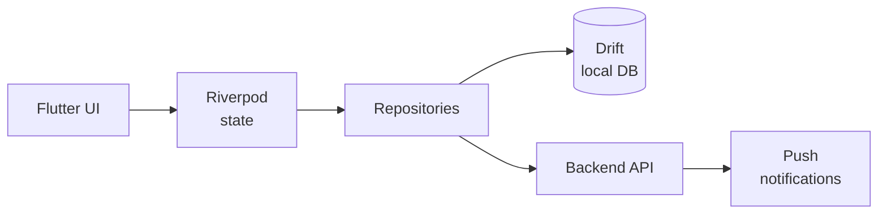
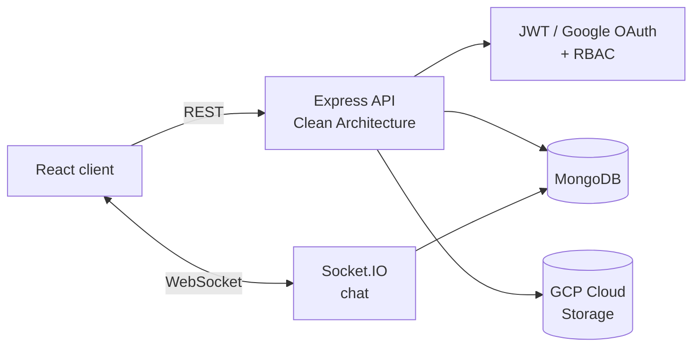
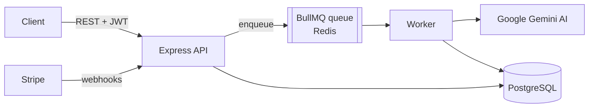

<!-- ===================== HEADER ===================== -->
<p align="center">
  
</p>

<p align="center">
  <a href="https://www.buildbymidhun.me/">
    
  </a>
</p>

<p align="center">
  <a href="https://www.buildbymidhun.me/"></a>
  <a href="https://www.linkedin.com/in/midhunpm6060"></a>
  <a href="mailto:midhunpm6060@gmail.com"></a>
  
</p>

<p align="center">
  <a href="#-about-me">About</a> •
  <a href="#-tech-stack">Tech Stack</a> •
  <a href="#-featured-projects">Projects</a> •
  <a href="#-career-journey">Journey</a> •
  <a href="#-github-activity">Activity</a> •
  <a href="#-lets-connect">Connect</a>
</p>

---

## 👨‍💻 About Me

```yaml
name:      Midhun P M
role:      Full Stack Developer @ Flytdeck AI Private Limited
location:  Trivandrum, Kerala, India
focus:     [Scalable web apps, Cross-platform mobile, Secure backends]
strengths: [REST API design, JWT/OAuth/RBAC, Real-time (Socket.IO), Async queues (BullMQ + Redis)]
approach:  Clean Architecture · maintainable code · performance-first
currently: Building an enterprise ship management app in Flutter
```

> 🔄 I moved into software development after **4+ years in IT and customer support**. That's why I build with real users and real failure cases in mind.

---

## 🛠️ Tech Stack

<p align="center">
  
  <br/>
  
</p>

<details>
<summary><b>📋 View the full breakdown</b></summary>
<br/>

| Area | Tools |
|---|---|
| **Languages** | JavaScript, TypeScript, Dart, HTML, CSS |
| **Frontend** | React.js, Next.js, Redux Toolkit, Tailwind CSS |
| **Mobile** | Flutter, Riverpod, Drift (offline-first local DB) |
| **Backend** | Node.js, Express.js, Socket.IO, RESTful APIs |
| **Databases & ORM** | MongoDB, PostgreSQL, TypeORM |
| **Queues & Caching** | Redis, BullMQ |
| **Auth & Payments** | JWT, Google OAuth, RBAC, OTP, Stripe (webhooks) |
| **Cloud & DevOps** | Docker, CI/CD, GCP Cloud Storage, AWS |
| **Architecture** | Clean Architecture, MVC, Microservices |
| **Tools** | Git, GitHub, Postman, Jira |

</details>

---

## 📌 Featured Projects

### 🚢 Ship Management Mobile App
**Enterprise · Flytdeck AI · Private** &nbsp;


A cross-platform app for managing end-to-end ship operations, crew and site data across a fleet.

<details>
<summary><b>🔍 Modules & architecture</b></summary>
<br/>

| Module | What it does |
|---|---|
| **PMS** | Planned maintenance scheduling and task tracking |
| **QHSE** | Quality, health, safety and environment compliance reporting |
| **Inventory & Procurement** | Stock levels and purchase workflows |
| **Cash Box** | Onboard expense and transaction tracking |
| **Crew Profiles** | Crew records and documentation |
| **Multi-site switcher** | Switch between ships/sites in one app |
| **Push notifications** | Real-time alerts and updates |



</details>

---

### 💼 WorkBridge — Job Portal


A full-stack job portal connecting job seekers and employers, built on Clean Architecture.

<p>
  <a href="#"></a>
  <a href="https://github.com/MidhunPM6/WorkBridge_Job_Portal-front-end"></a>
  <a href="#"></a>
</p>

<details>
<summary><b>🔍 Features & architecture</b></summary>
<br/>

- 🔐 **JWT + Google OAuth** login with **role-based access control** (seekers / employers)
- 💬 **Real-time chat** between candidates and recruiters via Socket.IO
- 📁 Resume and file uploads to **GCP Cloud Storage** (Multer)
- 🎨 Responsive UI with React, Tailwind, React Router and Redux Toolkit
- 🐳 Dockerized, with **CI/CD** for automated build and deploy



</details>

---

### 🤖 Google Gemini AI Chat Backend


A production-ready backend that lets authenticated users chat with Google Gemini AI, with subscription-based access.

<p>
  <a href="#"></a>
</p>

<details>
<summary><b>🔍 Features & architecture</b></summary>
<br/>

- 🔑 **OTP-based login** with JWT sessions and password management
- ⚡ **Async AI processing** with BullMQ + Redis, so the API stays fast under load
- 💳 **Stripe subscriptions** with webhook-driven payment handling
- 🗄️ REST APIs for profiles, chatrooms and messages, backed by **PostgreSQL**



</details>

---

## 🧭 Career Journey

<details>
<summary><b>📅 View my timeline</b></summary>
<br/>

| Period | Role | Company |
|---|---|---|
| **Mar 2026 – Present** | 💻 Full Stack Developer | Flytdeck AI Private Limited |
| Feb 2022 – Jun 2024 | 🛠️ IT Support Executive | Wintech Technology, Abu Dhabi, UAE |
| Aug 2021 – Jan 2022 | 🛠️ IT Support Executive | Aforeserve IT Solutions, Kochi |
| Jan 2020 – Feb 2021 | 🎧 Customer Support Executive | Maksys Technology, Kozhikode |

</details>

---

## 📊 GitHub Activity

<p align="center">
  
  
</p>

<p align="center">
  
</p>

---

## 🤝 Let's Connect

<p align="center">
  I'm open to <b>full-stack and backend roles</b> and to collaborating on interesting products.<br/><br/>
  <a href="https://www.linkedin.com/in/midhunpm6060"></a>
  <a href="mailto:midhunpm6060@gmail.com"></a>
</p>

<p align="center">
  
</p>

<!--
TODO before committing:
1. Replace the "#" links: WorkBridge Live Demo, WorkBridge Backend, Gemini Source.
2. Check the LinkedIn URL.
3. Check that the architecture diagrams match how your projects are actually built.
-->
